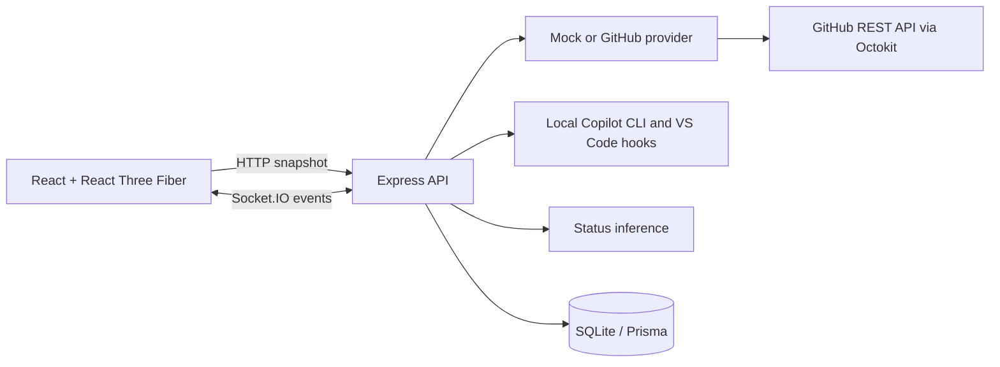

# Copilot Agent Office

A locally hosted monitoring dashboard for GitHub Copilot agents. The office is a procedural, low-poly 3D scene; agent status is explicitly labeled as mock, directly reported by local hooks, or inferred from observable GitHub activity.

## Quick start

### Windows one-click setup and launch

Install **Node.js LTS 22.13 or newer** and npm, then double-click
`Install-Agent-Office.cmd`. Setup installs dependencies, applies database migrations,
builds the app, and creates a **Copilot Agent Office** desktop shortcut. It does not
reset your database, overwrite an existing `.env`, or require administrator rights.

Double-click the shortcut (or `Launch-Agent-Office.cmd`) to start the built app and
open your browser. The launcher runs the server in the background; its window can close.
Use `Stop-Agent-Office.cmd` to stop the background server owned by this folder.
Use `Restart-Agent-Office.cmd` to stop and relaunch it in one step. For network
sharing, run `.\Restart-Agent-Office.cmd -Share`; add `-NoBrowser` to avoid opening
another browser tab. Restart uses the existing build; it does not rebuild source changes.
Logs are in `.agent-office\server.log` and `.agent-office\server-error.log`.
For console debugging, run `.\Launch-Agent-Office.cmd -Foreground` and keep that window open.
By default the built dashboard and API share **http://127.0.0.1:4000**.
An already-running office is reused rather than starting a duplicate.

### View the office from other computers

Double-click `Share-Agent-Office.cmd` (or run `.\Launch-Agent-Office.cmd -Share`) to listen
on your network. The launcher prints the addresses other computers can open, such as
`http://<this-computer-name>:4000`. To always share, set `HOST=0.0.0.0` in `.env`.
If the office is already running without sharing, stop it first with `Stop-Agent-Office.cmd`.

- Other computers are **view-only**: settings, agent colors, demo events, and lifecycle hooks
  can only be changed from the host computer (they receive `403 VIEW_ONLY`). Refresh is allowed.
- Viewers can see agent names, folder names, and token/AI-credit usage. There is no login
  and traffic is plain HTTP, so share only on a trusted private network or VPN.
- Windows Firewall must allow inbound TCP on the port. Run the launcher once as administrator
  to add a Private/Domain rule automatically, or accept the Node.js firewall prompt.

After updating the source, stop the running office and double-click
`Build-Agent-Office.cmd` to rebuild it, then use `Launch-Agent-Office.cmd` again.
Build only compiles the app; it does not change your settings, reset the database,
install dependencies, or recreate shortcuts. If dependencies changed, run
`Install-Agent-Office.cmd` instead.

To also install the user-level Copilot lifecycle hooks during setup, run:

```powershell
.\Install-Agent-Office.cmd -ConnectAgents
```

Keep the repository folder in place: shortcuts and hooks reference it. Stop the
running office before rerunning setup after an update (Windows locks native database
libraries while they are in use). For scripted use, setup accepts `-NoShortcut` and
the launcher accepts `-NoBrowser`. Node.js is a prerequisite, not bundled or installed
automatically. This is a local source-folder installation, not a standalone `.exe`.

### New chats, worktrees, and separate installations

A Copilot chat may create a separate Git worktree. That folder contains source code,
but does **not** inherit the original installation's ignored `.env`, SQLite database,
dependencies, or built application files. Changes in a worktree do not automatically
update the original installation.

If launch reports **“Settings are missing”**, the new folder has no `.env`.
For an independent installation, run `Install-Agent-Office.cmd` in that folder.
To reuse startup configuration, first copy your original `.env` into the new folder;
setup preserves it. Keep this file private because it may contain credentials.
Relative database paths refer to the new installation's database, not the original
database. Do not point two running instances at the same database.

Stop the original instance before starting another on the same port, or give each
instance different `PORT` and `WEB_PORT` values. The launcher reuses an existing
Agent Office on its configured port; it does not switch that server to the new folder's
code. Setup creates a desktop shortcut pointing to its own folder; use `-NoShortcut`
to keep an existing shortcut unchanged.

### Development

Prerequisites: Node.js 22.13+ and npm 10+.

```powershell
npm install
Copy-Item .env.example .env
npm run db:migrate
npm run db:seed
npm run dev
```

Open http://127.0.0.1:5173. Mock mode is the default and needs no credentials.

After building, `npm start` runs the production dashboard and API together on port 4000.

## Architecture



## Stack and structure

- `apps/web`: React, TypeScript, Vite, Three.js / React Three Fiber, Zustand, Tailwind, Lucide.
- `apps/server`: Express, Socket.IO, Octokit, Zod, Prisma and SQLite.
- `packages/shared`: schemas, status model, rules, deterministic color and desk layout helpers.

## GitHub mode

Set `AGENT_PROVIDER=github`, `GITHUB_TOKEN`, and `GITHUB_ORG` in `.env`. Optionally set comma-separated `GITHUB_REPOSITORIES`. Use a fine-grained token with read-only repository metadata, issues, pull requests, checks, actions, and contents permissions only as applicable. No token is sent to the browser or saved in SQLite.

GitHub does not expose a general Copilot coding-agent session/telemetry API. GitHub mode therefore reports **inferred** activity from supported repository activity, checks, workflows, issues, and pull requests; the application does not claim direct session telemetry. Provider snapshots are retained on transient failure.

## Connect local Copilot sessions

The default mock workspace is sample data. To connect local Copilot CLI and VS Code agent sessions instead, run this once from the repository root:

```sh
npm run connect:agents
```

This creates a user-level Copilot hook file under `%USERPROFILE%\.copilot\hooks` on Windows (or `~/.copilot/hooks` elsewhere), generates a local bearer token in `.env`, and switches `AGENT_PROVIDER` to `local`. Restart the server (`Restart-Agent-Office.cmd` for the built app, or restart `npm run dev`), then start or resume Copilot CLI sessions or VS Code **local** agent-harness sessions. The dashboard will show real sessions as their lifecycle events arrive; it does not import the mock roster into local mode. Use `npm run disconnect:agents` to remove the Agent Office hook file and return to mock mode.

Hooks reference the installation folder. To move monitoring to a new installation,
run `npm run connect:agents` from the destination folder and restart its server.
Changing only the browser URL does not redirect lifecycle hooks.
Only one Agent Office hook registration is installed per user. The generated hook
file targets API port **4000**; if the destination uses a different port, update
`AGENT_OFFICE_HOOK_URL` in each event entry of that hook file to match. Rerunning
`connect:agents` regenerates those entries with the default port.

The hook bridge listens only on the loopback API and authenticates with the generated token. It sends lifecycle event, opaque session identity, runtime, and workspace folder name only—never prompts, transcripts, tool arguments, or tool results. CLI session-end hooks report completion/error; VS Code local hooks report working/idle lifecycle events. Remote/cloud VS Code sessions do not report to this local bridge.

## Environment variables

Change the dashboard heading in **Office settings → Office title**, then save the settings.
The title is stored in SQLite, applies immediately, and survives reloads and server restarts.
It accepts 1–120 characters (excluding surrounding whitespace); the default is
“Good work happens together.”

See `.env.example`. Startup validates configuration. `GITHUB_TOKEN` is optional in mock mode. The server binds to `127.0.0.1` by default; `HOST=0.0.0.0` (or the `-Share` launcher switch) shares a view-only office on the network.

### Copy settings between instances

Settings saved in **Office settings** are stored in that instance's SQLite database.
Export them from the running source instance using PowerShell (replace `4000` with
its API port):

```powershell
$config = (Invoke-RestMethod 'http://127.0.0.1:4000/api/v1/config').data
$config | ConvertTo-Json -Depth 10 | Set-Content '.\office-settings.json' -Encoding utf8
```

Transfer `office-settings.json` to the destination computer, then run this **on the
destination host**, with its server running and the URL adjusted to its API port:

```powershell
Invoke-RestMethod 'http://127.0.0.1:4000/api/v1/config' `
  -Method Put -ContentType 'application/json' `
  -Body (Get-Content '.\office-settings.json' -Raw)
```

The import persists dashboard settings, but does not copy agents, colors, history,
credentials, hook registration, or startup configuration. The destination keeps its
`AGENT_PROVIDER` from `.env`. Configure ports, database paths, tokens, and usage-source
paths separately in `.env`; a configuration API export is not a substitute for that
file. Camera position, view, labels, shadows, list mode, and other display preferences
are stored separately in the browser's local storage.

## Commands

| Command                                                | Purpose                                                                                               |
| ------------------------------------------------------ | ----------------------------------------------------------------------------------------------------- |
| `npm run dev`                                          | Run web and server together                                                                           |
| `npm run dev:web` / `npm run dev:server`               | Run one development service                                                                           |
| `npm run build`                                        | Build all workspaces                                                                                  |
| `npm start`                                            | Run the built production dashboard and API                                                            |
| `npm run lint` / `npm run typecheck`                   | Static checks                                                                                         |
| `npm run test` / `npm run test:e2e`                    | Unit/integration and Playwright checks (install Chromium once with `npx playwright install chromium`) |
| `npm run test:production`                              | Build and check rendering under production security headers using an isolated mock database           |
| `npm run format`                                       | Format supported source                                                                               |
| `npm run db:migrate` / `npm run db:seed`               | Set up and seed local SQLite                                                                          |
| `npm run db:reset`                                     | Reset local development data                                                                          |
| `npm run connect:agents` / `npm run disconnect:agents` | Install/remove local Copilot lifecycle hooks                                                          |

Docker alternative: `docker compose up --build`; the database is persisted in the `agent-office-data` volume. Pass GitHub configuration through environment variables, not the image.

## Status inference

Status rules and limitations are detailed in [docs/status-rules.md](docs/status-rules.md). Mock statuses are deterministic demo fixtures/events. GitHub activity is inferred and includes evidence, timestamp, confidence, and a human-readable explanation. “Direct” status is reserved for provider data that explicitly provides the status; no GitHub session API is assumed.

### Idle agents, away desks, and couch capacity

- **Idle agents keep their desks** while relaxing in the lounge. For local sessions,
  the **Idle delay (seconds)** setting controls the wait after a turn stops before
  moving from Needs attention to Idle; the default is **20 seconds**.
- Local agents with no activity become **Offline** after **Offline threshold
  (minutes)**, **60 minutes by default**. The threshold is based on last activity,
  not time spent on the couch. Completed and failed local sessions do not automatically
  time out under this rule.
- On the next successful provider refresh, offline agents and working agents explicitly
  reporting `officeActivity: "away"` have their desks cleared and are excluded from the
  office roster and headcount. Missing agents are marked offline. Cleanup happens
  **before** allocating new desks, and remaining desks are compacted.
- Profiles, saved colors, usage, and activity history remain stored. Returning agents
  receive an available desk. Joining and queued agents keep their desks; a failed provider
  fetch does not clear the last office snapshot.
- The existing lounge has **eight seats**. Additional couch bays are added only when
  there are **more than eight present agents**, excluding away agents. Idle, completed,
  joining, and queued agents still count. Filters do not change capacity; when headcount
  shrinks, occupants of removed bays move into remaining seats.

There is no extra offline desk-retention delay. The legacy `retainOfflineHours` API
configuration field remains accepted for compatibility but no longer controls cleanup,
and its settings control has been removed. **Send home** is a separate manual dismissal
with an approximately **12.5-second** departure, described below.

## Security and troubleshooting

Use the **Office view** selector on the floor to switch between Isometric, Front,
Left, Right, and Top down. Pan and zoom work in every view; Reset camera restores
the selected view. Front and side views look down at 45 degrees to keep the floor visible.
Scene labels face the camera, with agent captions beside desks in side views and
above their subjects in top-down views. Side and overhead presets use wider framing.
The **Show agent source** setting hides or shows CLI/VS Code prefixes in agent names
throughout the dashboard and floor; it is remembered in this browser. Agents needing
attention wave one raised arm (a static raised arm with reduced motion).
Completion plays a 12-second cheer, celebratory sway, and farewell wave before settling.
After the celebration, completed agents relax on the couch while retaining their
Completed status and history. Sessions already completed when the dashboard opens
go directly to the lounge if their celebration period has elapsed. Lounge agents
occasionally visit the water cooler or kitchenette, returning with a drink or a
different relaxation activity. They also occasionally take a break at the arcade
cabinet or pinball table (labelled "Playing
arcade" / "Playing pinball"); reduced motion disables these breaks.
When a local agent's pull request is merged, it parties at its desk for 14 seconds (jump,
wave, floss, confetti); this needs the GitHub CLI signed in (`gh auth login`). See
[docs/local-copilot-hooks.md](docs/local-copilot-hooks.md#pull-request-merge-party).
To clear unwanted agents from the floor, click an agent and choose **Send home**.
It walks to its desk, switches off the monitor, picks up its coffee and follows
clear aisles around furniture to the office boundary, where it disappears;
the desk and chair disappear in a puff of smoke. The departure takes about 12.5 seconds.
This is a persistent office dismissal, not a command to stop the actual Copilot session.
The agent stays hidden across refreshes and server restarts until it reports fresh work,
then returns with its saved color and history. Sending home is available on the host PC;
network viewers remain read-only.
**Local Copilot History retains all token/credit totals, folder details and exact
agent attribution**, including agents sent home.
Attention uses a repeating 8-second wave-and-scan sequence until its status changes.
Neither animation extends the configured waiting/idle timeout or blocks new work.
Typing uses alternating raised keystrokes, lateral hand travel, wrist motion, and a subtle
upper-body rhythm, with brief pauses to look up at the screen.
Watching-task agents have an animated monitor activity indicator (decorative, not measured
task progress). Working desk agents occasionally lift their coffee cup for a sip;
reduced-motion mode keeps the cup on the desk and the monitor indicator static.
Every desk activity has a decorative monitor display: a dashboard, growing code,
document reading highlight, search results, terminal output, delegation diagram,
context folders, diagnostics, attention prompt, completion confirmation, screensaver,
or standby. Displays never show actual prompts, code, or tool output. They refresh
at up to 12 frames per second and remain static with reduced motion.
The attention queue shows waiting time and sorts oldest requests first, using the
hook's waiting-start timestamp when available, otherwise the agent update timestamp.
Selecting an entry opens its profile; provider task links are available there.
Local hooks do not expose reliable editor/terminal session links.
Your view, zoom, pan, and display preferences are remembered in this browser.

Typing `party` outside a form field (or entering the Konami code) starts a
browser-only lounge party. Typing `boss` makes lounge agents hurry back to their
desks and pretend to work for 15 seconds. Neither changes provider status; real work
takes priority, and reduced motion suppresses travel and animated poses.

### Folder and agent token usage

The usage panel includes **30-day folder totals** (the workspace folder name shown above
each desk), with input/output counts, AI credits, sources, and session/call coverage.
The repository is listed under a folder when Copilot CLI recorded it. Agent profiles, roster entries, and list rows show **30-day
input + output totals** when an exact local-history session identity matches.
These are two breakdowns of the same data: do not add agent totals to folder totals.
Cache-token counters are not added to input/output, and unavailable counts remain
**Not reported**, not zero.

**AI credits** are shown alongside tokens for the 30-day total, each folder, each
matched agent and the unattributed bucket. They come from the `total_nano_aiu` value
Copilot records for each call (1 AI credit = 1,000,000,000 nano AI units), not from an
estimate. A total is marked **(partial)** when some calls have no recorded value, and
older databases without the column show **Not reported**.

The adapter opens `~/.copilot/session-store.db` read-only (override with
`COPILOT_USAGE_DB_PATH`), reading only usage counters, session identities, and repository
metadata. It never reads conversations, prompts, or tool contents. Root sessions only
receive root calls; a child's counters require both an exact child identity and a
matching parent. Unknown children and sessions without an exact office match remain
**Unattributed** to agents. Sessions without a recorded folder have their own
**Folder not reported** bucket.

**VS Code usage** is read from VS Code's local chat session logs
(`%APPDATA%\Code\User\workspaceStorage\*\chatSessions\*.jsonl` on Windows, plus empty-window
sessions). Only request timestamps, `promptTokens`, `completionTokens`, and `copilotCredits`
are kept; prompts and responses are discarded while parsing. The folder comes from the
workspace's `workspace.json`. A chat log's file name is the VS Code session ID, so usage
is attributed to the matching VS Code desk exactly (subagent usage stays with the root
agent). VS Code counts are **requests**, which may each contain several model calls.
Set `VSCODE_USAGE_TRACKING=false` to disable this source, or `VSCODE_USER_DATA_PATH` to
point at a different VS Code user-data folder (for example VS Code Insiders). The panel
lists each source's totals separately. An incompatible database schema is reported explicitly.
Usage refreshes every minute and does not overwrite hook-supplied token counters.

Use **Enter fullscreen** in the office controls to expand only the office floor.
View selection, pan, and zoom remain available; use **Exit fullscreen** or **Esc**
to return to the dashboard.

Select an agent to open its profile (also in fullscreen, where it docks on the left).
Click anywhere outside the profile, or press **Esc**, to close it. The roster search and
status filter narrow the agent list.

If the production dashboard loads but the office stays blank, update and rebuild the
server as well as the web app with `Build-Agent-Office.cmd`. The 3D text renderer requires blob workers/generated
modules and font data from the pinned unicode-font-resolver CDN path; the production
Content Security Policy explicitly permits those resources. Font loading requires
access to `cdn.jsdelivr.net`. Local HTTP hosting does not enable HTTPS upgrade directives.

**“Preparing your office”** appears only while the initial office state is loading.
After a successful load with no present agents, the dashboard shows **“The office is
empty”**; scenery without desks is expected. In local mode, start or resume a connected
Copilot session to send new lifecycle events. Offline/away agents do not keep empty desks.
Use **Refresh** to reload the snapshot. If active agents are reported but desks still
do not appear, check provider health, browser errors, and the server logs.

Run `npm run test:production` to build the application and check that the office
renders under production headers without browser errors, using an isolated mock database.

The GitHub adapter is read-only. Requests are validated, content is rendered as text, secrets are excluded from API responses and logs, and Helmet applies a restrictive policy. If GitHub fails or is rate-limited, the last snapshot remains visible and provider health reports the problem; retries are delayed. Use `AGENT_PROVIDER=mock` to verify local setup without credentials.

## Extending

Implement `AgentProvider` in `apps/server/src/providers`, return normalized agents/activity/health, and register it in the provider factory. Add normalized status evidence in `packages/shared/src/status.ts`. Avatar poses live in `apps/web/src/office/AgentAvatar.tsx`; furniture is composed in `Workstation.tsx`. See [docs/architecture.md](docs/architecture.md), [docs/github-integration.md](docs/github-integration.md), and [docs/3d-scene.md](docs/3d-scene.md).
