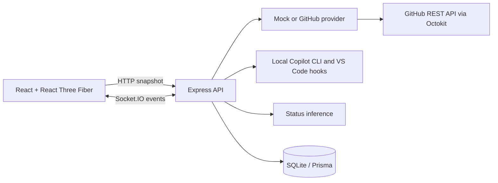

# Copilot Agent Office

A locally hosted monitoring dashboard for GitHub Copilot agents. The office is a procedural, low-poly 3D scene; agent status is explicitly labeled as mock, directly reported by local hooks, or inferred from observable GitHub activity.

> Screenshot: add a local dashboard screenshot here.

## Quick start

### Windows one-click setup and launch

Install **Node.js LTS 22.13 or newer** and npm, then double-click
`Install-Agent-Office.cmd`. Setup installs dependencies, applies database migrations,
builds the app, and creates a **Copilot Agent Office** desktop shortcut. It does not
reset your database, overwrite an existing `.env`, or require administrator rights.

Double-click the shortcut (or `Launch-Agent-Office.cmd`) to start the built app and
open your browser. The launcher keeps a console open; close it or press Ctrl+C to stop.
By default the built dashboard and API share **http://127.0.0.1:4000**.
An already-running office is reused rather than starting a duplicate.

To also install the user-level Copilot lifecycle hooks during setup, run:

```powershell
.\Install-Agent-Office.cmd -ConnectAgents
```

Keep the repository folder in place: shortcuts and hooks reference it. Close the
running office before rerunning setup after an update (Windows locks native database
libraries while they are in use). For scripted use, setup accepts `-NoShortcut` and
the launcher accepts `-NoBrowser`. Node.js is a prerequisite, not bundled or installed
automatically. This is a local source-folder installation, not a standalone `.exe`.

### Development

Prerequisites: Node.js 20+, npm 10+.

```sh
npm install
cp .env.example .env
npm run db:migrate
npm run db:seed
npm run dev
```

Open http://127.0.0.1:5173. Mock mode is the default and needs no credentials.

After building, `npm start` runs the production dashboard and API together on port 4000.

## Architecture



## Stack and structure

- `apps/web`: React, TypeScript, Vite, Three.js / React Three Fiber, Zustand, Tailwind, Lucide.
- `apps/server`: Express, Socket.IO, Octokit, Zod, Prisma and SQLite.
- `packages/shared`: schemas, status model, rules, deterministic color and desk layout helpers.

## GitHub mode

Set `AGENT_PROVIDER=github`, `GITHUB_TOKEN`, and `GITHUB_ORG` in `.env`. Optionally set comma-separated `GITHUB_REPOSITORIES`. Use a fine-grained token with read-only repository metadata, issues, pull requests, checks, actions, and contents permissions only as applicable. No token is sent to the browser or saved in SQLite.

GitHub does not expose a general Copilot coding-agent session/telemetry API. GitHub mode therefore reports **inferred** activity from supported repository activity, checks, workflows, issues, and pull requests; the application does not claim direct session telemetry. Provider snapshots are retained on transient failure.

## Connect local Copilot sessions

The default mock workspace is sample data. To connect local Copilot CLI and VS Code agent sessions instead, run this once from the repository root:

```sh
npm run connect:agents
```

This creates a user-level Copilot hook file under `%USERPROFILE%\.copilot\hooks` on Windows (or `~/.copilot/hooks` elsewhere), generates a local bearer token in `.env`, and switches `AGENT_PROVIDER` to `local`. Restart `npm run dev`, then start or resume Copilot CLI sessions or VS Code **local** agent-harness sessions. The dashboard will show real sessions as their lifecycle events arrive; it does not import the mock roster into local mode. Use `npm run disconnect:agents` to remove the Agent Office hook file and return to mock mode.

The hook bridge listens only on the loopback API and authenticates with the generated token. It sends lifecycle event, opaque session identity, runtime, and workspace folder name only—never prompts, transcripts, tool arguments, or tool results. CLI session-end hooks report completion/error; VS Code local hooks report working/idle lifecycle events. Remote/cloud VS Code sessions do not report to this local bridge.

## Environment variables

Change the dashboard heading in **Office settings → Office title**, then save the settings.
The title is stored in SQLite, applies immediately, and survives reloads and server restarts.
It accepts 1–120 characters (excluding surrounding whitespace); the default is
“Good work happens together.”

See `.env.example`. Startup validates configuration. `GITHUB_TOKEN` is optional in mock mode. The server binds to `127.0.0.1` by default.

## Commands

| Command                                                | Purpose                                                                                               |
| ------------------------------------------------------ | ----------------------------------------------------------------------------------------------------- |
| `npm run dev`                                          | Run web and server together                                                                           |
| `npm run dev:web` / `npm run dev:server`               | Run one development service                                                                           |
| `npm run build`                                        | Build all workspaces                                                                                  |
| `npm run lint` / `npm run typecheck`                   | Static checks                                                                                         |
| `npm run test` / `npm run test:e2e`                    | Unit/integration and Playwright checks (install Chromium once with `npx playwright install chromium`) |
| `npm run format`                                       | Format supported source                                                                               |
| `npm run db:migrate` / `npm run db:seed`               | Set up and seed local SQLite                                                                          |
| `npm run db:reset`                                     | Reset local development data                                                                          |
| `npm run connect:agents` / `npm run disconnect:agents` | Install/remove local Copilot lifecycle hooks                                                          |

Docker alternative: `docker compose up --build`; the database is persisted in the `agent-office-data` volume. Pass GitHub configuration through environment variables, not the image.

## Status inference

Status rules and limitations are detailed in [docs/status-rules.md](docs/status-rules.md). Mock statuses are deterministic demo fixtures/events. GitHub activity is inferred and includes evidence, timestamp, confidence, and a human-readable explanation. “Direct” status is reserved for provider data that explicitly provides the status; no GitHub session API is assumed.

## Security and troubleshooting

The GitHub adapter is read-only. Requests are validated, content is rendered as text, secrets are excluded from API responses and logs, and Helmet applies a restrictive policy. If GitHub fails or is rate-limited, the last snapshot remains visible and provider health reports the problem; retries are delayed. Use `AGENT_PROVIDER=mock` to verify local setup without credentials.

## Extending

Implement `AgentProvider` in `apps/server/src/providers`, return normalized agents/activity/health, and register it in the provider factory. Add normalized status evidence in `packages/shared/src/status.ts`. Avatar poses live in `apps/web/src/office/AgentAvatar.tsx`; furniture is composed in `Workstation.tsx`. See [docs/architecture.md](docs/architecture.md), [docs/github-integration.md](docs/github-integration.md), and [docs/3d-scene.md](docs/3d-scene.md).
