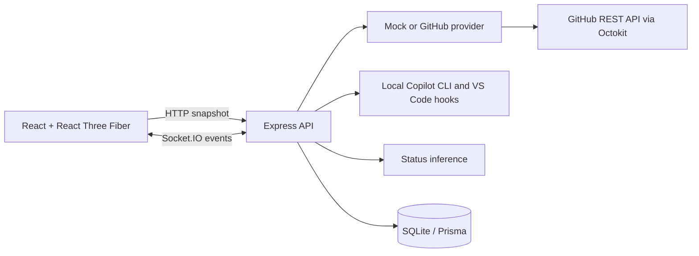

# Copilot Agent Office

A locally hosted monitoring dashboard for GitHub Copilot agents. The office is a procedural, low-poly 3D scene; agent status is explicitly labeled as mock, directly reported by local hooks, or inferred from observable GitHub activity.

> Screenshot: add a local dashboard screenshot here.

## Quick start

### Windows one-click setup and launch

Install **Node.js LTS 22.13 or newer** and npm, then double-click
`Install-Agent-Office.cmd`. Setup installs dependencies, applies database migrations,
builds the app, and creates a **Copilot Agent Office** desktop shortcut. It does not
reset your database, overwrite an existing `.env`, or require administrator rights.

Double-click the shortcut (or `Launch-Agent-Office.cmd`) to start the built app and
open your browser. The launcher runs the server in the background; its window can close.
Use `Stop-Agent-Office.cmd` to stop the background server owned by this folder.
Logs are in `.agent-office\server.log` and `.agent-office\server-error.log`.
For console debugging, run `.\Launch-Agent-Office.cmd -Foreground` and keep that window open.
By default the built dashboard and API share **http://127.0.0.1:4000**.
An already-running office is reused rather than starting a duplicate.

After updating the source, stop the running office and double-click
`Build-Agent-Office.cmd` to rebuild it, then use `Launch-Agent-Office.cmd` again.
Build only compiles the app; it does not change your settings, reset the database,
install dependencies, or recreate shortcuts. If dependencies changed, run
`Install-Agent-Office.cmd` instead.

To also install the user-level Copilot lifecycle hooks during setup, run:

```powershell
.\Install-Agent-Office.cmd -ConnectAgents
```

Keep the repository folder in place: shortcuts and hooks reference it. Stop the
running office before rerunning setup after an update (Windows locks native database
libraries while they are in use). For scripted use, setup accepts `-NoShortcut` and
the launcher accepts `-NoBrowser`. Node.js is a prerequisite, not bundled or installed
automatically. This is a local source-folder installation, not a standalone `.exe`.

### Development

Prerequisites: Node.js 20+, npm 10+.

```sh
npm install
cp .env.example .env
npm run db:migrate
npm run db:seed
npm run dev
```

Open http://127.0.0.1:5173. Mock mode is the default and needs no credentials.

After building, `npm start` runs the production dashboard and API together on port 4000.

## Architecture



## Stack and structure

- `apps/web`: React, TypeScript, Vite, Three.js / React Three Fiber, Zustand, Tailwind, Lucide.
- `apps/server`: Express, Socket.IO, Octokit, Zod, Prisma and SQLite.
- `packages/shared`: schemas, status model, rules, deterministic color and desk layout helpers.

## GitHub mode

Set `AGENT_PROVIDER=github`, `GITHUB_TOKEN`, and `GITHUB_ORG` in `.env`. Optionally set comma-separated `GITHUB_REPOSITORIES`. Use a fine-grained token with read-only repository metadata, issues, pull requests, checks, actions, and contents permissions only as applicable. No token is sent to the browser or saved in SQLite.

GitHub does not expose a general Copilot coding-agent session/telemetry API. GitHub mode therefore reports **inferred** activity from supported repository activity, checks, workflows, issues, and pull requests; the application does not claim direct session telemetry. Provider snapshots are retained on transient failure.

## Connect local Copilot sessions

The default mock workspace is sample data. To connect local Copilot CLI and VS Code agent sessions instead, run this once from the repository root:

```sh
npm run connect:agents
```

This creates a user-level Copilot hook file under `%USERPROFILE%\.copilot\hooks` on Windows (or `~/.copilot/hooks` elsewhere), generates a local bearer token in `.env`, and switches `AGENT_PROVIDER` to `local`. Restart `npm run dev`, then start or resume Copilot CLI sessions or VS Code **local** agent-harness sessions. The dashboard will show real sessions as their lifecycle events arrive; it does not import the mock roster into local mode. Use `npm run disconnect:agents` to remove the Agent Office hook file and return to mock mode.

The hook bridge listens only on the loopback API and authenticates with the generated token. It sends lifecycle event, opaque session identity, runtime, and workspace folder name only—never prompts, transcripts, tool arguments, or tool results. CLI session-end hooks report completion/error; VS Code local hooks report working/idle lifecycle events. Remote/cloud VS Code sessions do not report to this local bridge.

## Environment variables

Change the dashboard heading in **Office settings → Office title**, then save the settings.
The title is stored in SQLite, applies immediately, and survives reloads and server restarts.
It accepts 1–120 characters (excluding surrounding whitespace); the default is
“Good work happens together.”

See `.env.example`. Startup validates configuration. `GITHUB_TOKEN` is optional in mock mode. The server binds to `127.0.0.1` by default.

## Commands

| Command                                                | Purpose                                                                                               |
| ------------------------------------------------------ | ----------------------------------------------------------------------------------------------------- |
| `npm run dev`                                          | Run web and server together                                                                           |
| `npm run dev:web` / `npm run dev:server`               | Run one development service                                                                           |
| `npm run build`                                        | Build all workspaces                                                                                  |
| `npm run lint` / `npm run typecheck`                   | Static checks                                                                                         |
| `npm run test` / `npm run test:e2e`                    | Unit/integration and Playwright checks (install Chromium once with `npx playwright install chromium`) |
| `npm run format`                                       | Format supported source                                                                               |
| `npm run db:migrate` / `npm run db:seed`               | Set up and seed local SQLite                                                                          |
| `npm run db:reset`                                     | Reset local development data                                                                          |
| `npm run connect:agents` / `npm run disconnect:agents` | Install/remove local Copilot lifecycle hooks                                                          |

Docker alternative: `docker compose up --build`; the database is persisted in the `agent-office-data` volume. Pass GitHub configuration through environment variables, not the image.

## Status inference

Status rules and limitations are detailed in [docs/status-rules.md](docs/status-rules.md). Mock statuses are deterministic demo fixtures/events. GitHub activity is inferred and includes evidence, timestamp, confidence, and a human-readable explanation. “Direct” status is reserved for provider data that explicitly provides the status; no GitHub session API is assumed.

## Security and troubleshooting

Use the **Office view** selector on the floor to switch between Isometric, Front,
Left, Right, and Top down. Pan and zoom work in every view; Reset camera restores
the selected view. Front and side views look down at 45 degrees to keep the floor visible.
Scene labels face the camera, with agent captions beside desks in side views and
above their subjects in top-down views. Side and overhead presets use wider framing.
The **Show agent source** setting hides or shows CLI/VS Code prefixes in agent names
throughout the dashboard and floor; it is remembered in this browser. Agents needing
attention wave one raised arm (a static raised arm with reduced motion).
Completion plays a 12-second cheer, celebratory sway, and farewell wave before settling.
After the celebration, completed agents relax on the couch while retaining their
Completed status and history. Sessions already completed when the dashboard opens
go directly to the lounge if their celebration period has elapsed.
Attention uses a repeating 8-second wave-and-scan sequence until its status changes.
Neither animation extends the configured waiting/idle timeout or blocks new work.
Typing uses alternating raised keystrokes, lateral hand travel, wrist motion, and a subtle
upper-body rhythm, with brief pauses to look up at the screen.
Watching-task agents have an animated monitor activity indicator (decorative, not measured
task progress). Working desk agents occasionally lift their coffee cup for a sip;
reduced-motion mode keeps the cup on the desk and the monitor indicator static.
Every desk activity has a decorative monitor display: a dashboard, growing code,
document reading highlight, search results, terminal output, delegation diagram,
context folders, diagnostics, attention prompt, completion confirmation, screensaver,
or standby. Displays never show actual prompts, code, or tool output. They refresh
at up to 12 frames per second and remain static with reduced motion.
The attention queue shows waiting time and sorts oldest requests first, using the
hook's waiting-start timestamp when available, otherwise the agent update timestamp.
Selecting an entry opens its profile; provider task links are available there.
Local hooks do not expose reliable editor/terminal session links.
Your view, zoom, pan, and display preferences are remembered in this browser.

### Folder and agent token usage

The usage panel includes **30-day folder totals** (the workspace folder name shown above
each desk), with input/output counts, AI credits, sources, and session/call coverage.
The repository is listed under a folder when Copilot CLI recorded it. Agent profiles, roster entries, and list rows show **30-day
input + output totals** when an exact local-history session identity matches.
These are two breakdowns of the same data: do not add agent totals to folder totals.
Cache-token counters are not added to input/output, and unavailable counts remain
**Not reported**, not zero.

**AI credits** are shown alongside tokens for the 30-day total, each folder, each
matched agent and the unattributed bucket. They come from the `total_nano_aiu` value
Copilot records for each call (1 AI credit = 1,000,000,000 nano AI units), not from an
estimate. A total is marked **(partial)** when some calls have no recorded value, and
older databases without the column show **Not reported**.

The adapter opens `~/.copilot/session-store.db` read-only (override with
`COPILOT_USAGE_DB_PATH`), reading only usage counters, session identities, and repository
metadata. It never reads conversations, prompts, or tool contents. Root sessions only
receive root calls; a child's counters require both an exact child identity and a
matching parent. Unknown children and sessions without an exact office match remain
**Unattributed** to agents. Sessions without a recorded folder have their own
**Folder not reported** bucket.

**VS Code usage** is read from VS Code's local chat session logs
(`%APPDATA%\Code\User\workspaceStorage\*\chatSessions\*.jsonl` on Windows, plus empty-window
sessions). Only request timestamps, `promptTokens`, `completionTokens`, and `copilotCredits`
are kept; prompts and responses are discarded while parsing. The folder comes from the
workspace's `workspace.json`. A chat log's file name is the VS Code session ID, so usage
is attributed to the matching VS Code desk exactly (subagent usage stays with the root
agent). VS Code counts are **requests**, which may each contain several model calls.
Set `VSCODE_USAGE_TRACKING=false` to disable this source, or `VSCODE_USER_DATA_PATH` to
point at a different VS Code user-data folder (for example VS Code Insiders). The panel
lists each source's totals separately. An incompatible database schema is reported explicitly.
Usage refreshes every minute and does not overwrite hook-supplied token counters.

Use **Enter fullscreen** in the office controls to expand only the office floor.
View selection, pan, and zoom remain available; use **Exit fullscreen** or **Esc**
to return to the dashboard.

Select an agent to open its profile (also in fullscreen, where it docks on the left).
Click anywhere outside the profile, or press **Esc**, to close it. The roster search and
status filter narrow the agent list.

If the production dashboard loads but the office stays blank, update and rebuild the
server as well as the web app with `Build-Agent-Office.cmd`. The 3D text renderer requires blob workers/generated
modules and font data from the pinned unicode-font-resolver CDN path; the production
Content Security Policy explicitly permits those resources. Font loading requires
access to `cdn.jsdelivr.net`. Local HTTP hosting does not enable HTTPS upgrade directives.

Run `npm run test:production` to build the application and check that the office
renders under production headers without browser errors, using an isolated mock database.

The GitHub adapter is read-only. Requests are validated, content is rendered as text, secrets are excluded from API responses and logs, and Helmet applies a restrictive policy. If GitHub fails or is rate-limited, the last snapshot remains visible and provider health reports the problem; retries are delayed. Use `AGENT_PROVIDER=mock` to verify local setup without credentials.

## Extending

Implement `AgentProvider` in `apps/server/src/providers`, return normalized agents/activity/health, and register it in the provider factory. Add normalized status evidence in `packages/shared/src/status.ts`. Avatar poses live in `apps/web/src/office/AgentAvatar.tsx`; furniture is composed in `Workstation.tsx`. See [docs/architecture.md](docs/architecture.md), [docs/github-integration.md](docs/github-integration.md), and [docs/3d-scene.md](docs/3d-scene.md).
