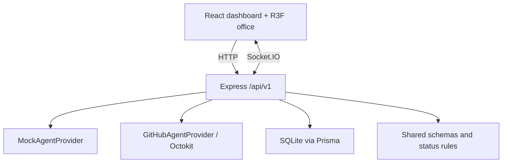

# Architecture

The npm-workspace monorepo separates the React dashboard and the Express service while sharing normalized Zod contracts and deterministic office layout helpers. The browser receives agent snapshots through HTTP and incremental updates through Socket.IO. The server owns provider access, credential handling, status normalization, desk allocation, and Prisma persistence.

At startup the server validates environment variables, runs an initial provider refresh, and polls at the configured interval. Existing IDs retain their workstation; absent records are changed to offline and their desks are reserved during the retention window. Browser refreshes merge records by stable ID to avoid duplicates.

The GitHub provider does not imply access to private Copilot session telemetry. Open pull requests by identities that include `copilot` or `agent` are observable candidates; their activity is explicitly marked **inferred**. Mock fixtures are **mock**. No provider currently marks live status as **direct**.
